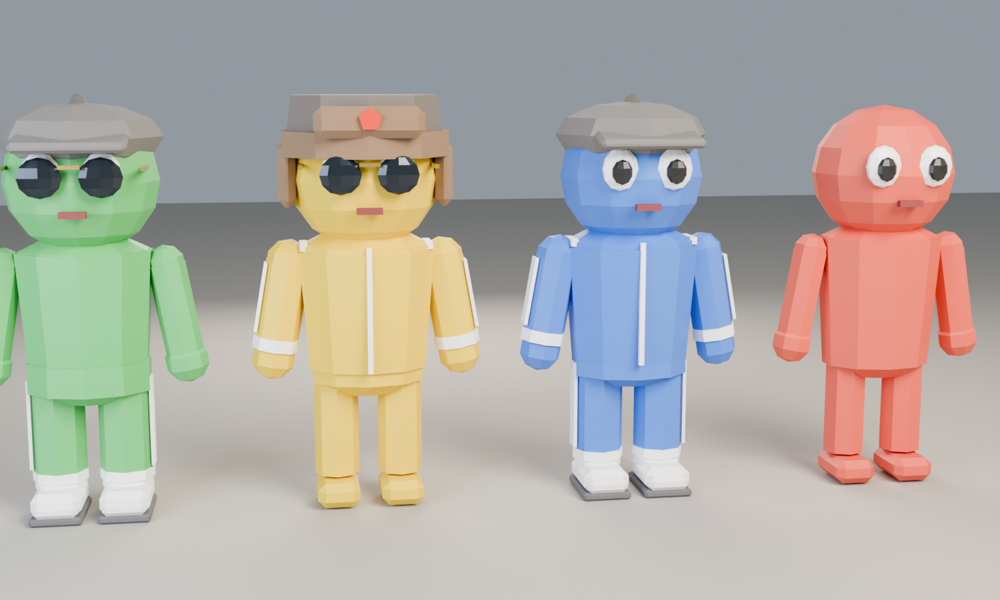

# SLAVIC GAMES

Кооперативная party-игра на 1–4 игроков в стиле 90-х и СССР: игровая доска, броски кубика и мини-игры между ходами.

- **Движок:** Godot 4.7 (GDScript)
- **Графика:** стилизованный low-poly
- **Платформа:** ПК, Steam

## Как открыть проект
1. Установи [Godot 4.7](https://godotengine.org/download) (версия **Standard**, не .NET).
2. Скачай репозиторий: зелёная кнопка **Code → Download ZIP** на GitHub, или `git clone`.
3. Запусти Godot → **Import** → выбери файл `project.godot` в папке проекта.
4. Нажми **F5** (или ▶ вверху справа), чтобы запустить игру.

## Как играть
1. В лобби каждый игрок входит своей кнопкой (см. таблицу ниже).
2. **Tab** (или **Start** на геймпаде) — начать партию. Если мест меньше 4, игра предложит
   добавить ботов (влево/вправо — сколько, кнопка подтверждения — начать).
3. На доске по очереди бросайте кубик своей кнопкой подтверждения и ходите.
   Синие клетки +₽, красные −₽, зелёные «?» — случайное событие.
4. Проходя ларёк **«ДЕФИЦИТ»**, можно купить дефицит за 20 ₽. У кого больше дефицита в конце — тот победил.
5. После каждого раунда — мини-игра. Призы за места выдаются рублями.

Переодеться можно на **рынке** в лобби (справа): встань в жёлтый круг и нажми свою кнопку
подтверждения. Вверх/вниз — выбрать вещь, влево/вправо — листать, подтверждение — готово.
Часть вещей бесплатна, остальные покупаются за рубли: рубли из каждой партии копятся в кошельке.
Наряд и покупки запоминаются за устройством (левая/правая клавиатура, геймпад).
Для тестов: **F9** в лобби — всем по 500 ₽. Каталог и цены: [docs/COSMETICS.md](docs/COSMETICS.md).



## Управление
| | Войти / прыжок | Движение | Выйти из лобби |
|---|---|---|---|
| Клавиатура, левая половина | Пробел или E | WASD | Q |
| Клавиатура, правая половина | Enter | Стрелки | Backspace / Shift |
| Геймпад | A | Левый стик / крестовина | B |

**Esc** в лобби закрывает игру, на доске и в мини-игре — выход в лобби.

## Структура проекта
```
autoload/        глобальные системы (PlayerManager, SceneManager)
scripts/core/    общие классы: данные игрока, ввод
scenes/          сцены игры (лобби, персонажи, позже доски и мини-игры)
assets/models/   3D-модели (.glb)
tools/blender/   скрипты, которыми сгенерированы модели
docs/            план разработки и дизайн-документы (ROADMAP, MINIGAMES)
```

Подробный план: [docs/ROADMAP.md](docs/ROADMAP.md).
